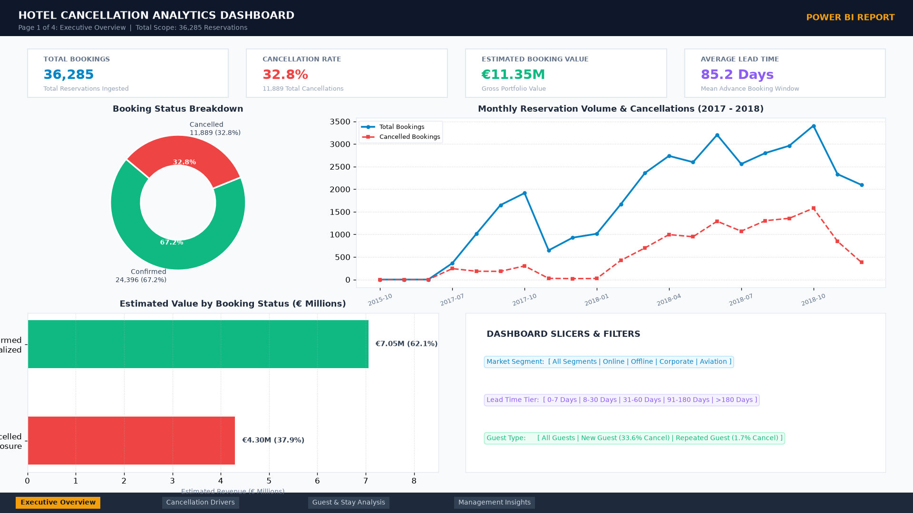
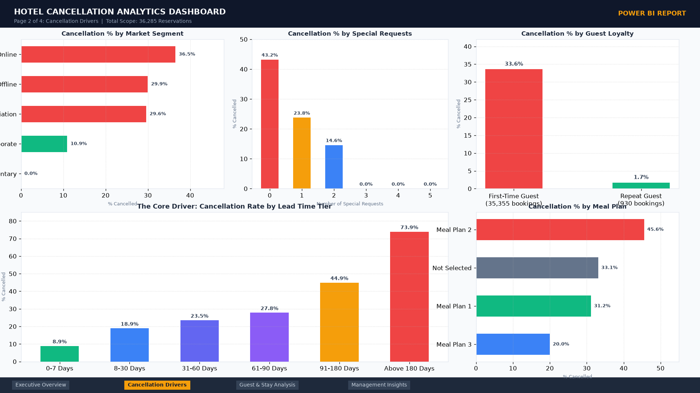
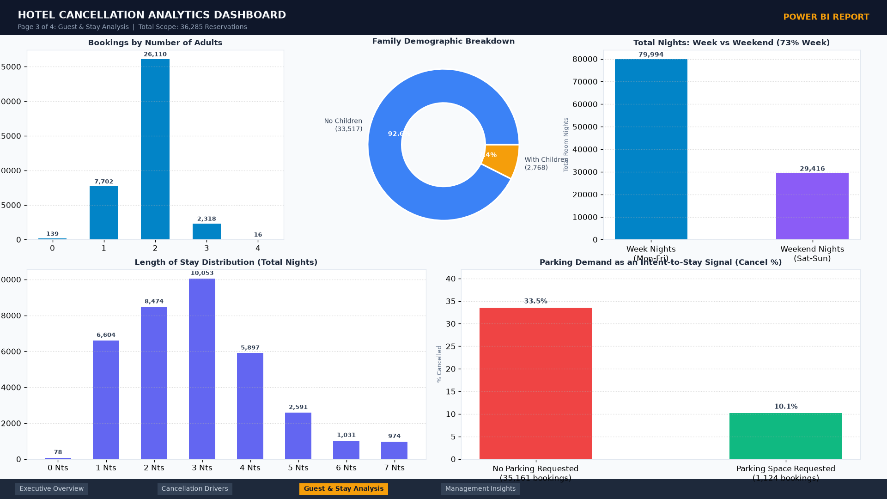
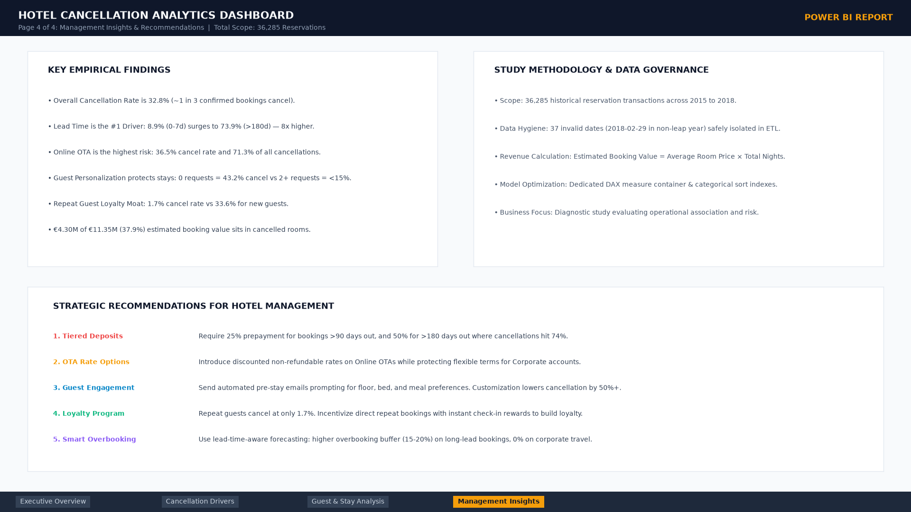

# 🏨 Hotel Booking Cancellation Analysis (Power BI)

A clean, easy-to-understand Power BI analytics project investigating why hotel reservations get cancelled and how hotel management can protect revenue.

---

## 📌 Project Overview

Hotel room cancellations lead to significant revenue loss and operational challenges. When guests cancel at the last minute, rooms often go unoccupied, impacting both room revenue and hotel operations (staffing, food preparation, etc.).

This project analyzes **36,285 historical hotel reservations** to understand:
- Why do guests cancel their bookings?
- Which customer segments and booking channels have the highest cancellation rates?
- What policies can hotel management implement to protect revenue?

---

## 📊 Dashboard Previews

### Page 1: Executive Overview
*High-level view of total bookings, overall cancellation rate (32.8%), €4.30M in revenue exposure, and multi-year booking trends.*


---

### Page 2: Cancellation Drivers
*Deep-dive into root causes: Lead time progression (8.9% up to 73.9%), market segments (Online OTAs at 36.5%), special requests impact, and guest loyalty.*


---

### Page 3: Guest & Stay Analysis
*Operational demand: Party sizes (adults & children), length of stay distribution, weekday vs. weekend demand (73% weekdays), and parking space signals.*


---

### Page 4: Management Insights & Recommendations
*Executive summary of findings, data governance notes, and an actionable 5-pillar revenue defense playbook.*


---

## 🎯 Key Metrics at a Glance

| Metric | Value | Meaning |
| :--- | :--- | :--- |
| **Total Bookings** | **36,285** | Total reservations analyzed |
| **Overall Cancellation Rate** | **32.8%** | About 1 in every 3 bookings gets cancelled |
| **Confirmed Bookings** | **24,396** (67.2%) | Bookings where guests checked in |
| **Total Portfolio Value** | **€11.35 Million** | Gross booking value across all reservations |
| **Value Lost to Cancellations** | **€4.30 Million** (37.9%) | Revenue exposed to cancellations |
| **Average Daily Rate (ADR)** | **€103.42** | Average price paid per room per night |
| **Average Lead Time** | **85.2 Days** | Average days between booking and arrival |

---

## 🔍 Key Insights & Findings

### 1. Lead Time is the #1 Driver of Cancellations
The further in advance a guest books, the more likely they are to cancel:
- **0 to 7 days before arrival:** only **8.9%** cancel.
- **8 to 30 days before arrival:** **18.9%** cancel.
- **91 to 180 days before arrival:** **44.9%** cancel.
- **More than 180 days out:** **73.9%** cancel (nearly 3 out of 4!).
> **Takeaway:** Long-lead reservations act as "free placeholders" when no deposit is required.

### 2. Online Bookings Have the Highest Cancellations
- **Online (OTAs like Booking.com, Expedia):** Makes up **64%** of all bookings and has a high **36.5%** cancellation rate.
- **Corporate Bookings:** Very reliable, with only a **10.9%** cancellation rate.

### 3. Special Requests Lower Cancellations Significantly
- Guests with **0 special requests** cancel **43.2%** of the time.
- Guests with **1 special request** cancel **23.8%** of the time.
- Guests with **2 or more requests** cancel **under 15%** of the time.
> **Takeaway:** When guests personalize their stay (requesting high floor, extra bed, etc.), they are far more likely to show up.

### 4. Repeat Guests Almost Never Cancel
- **New Guests:** **33.6%** cancellation rate.
- **Repeat Guests:** Only **1.7%** cancellation rate (only 16 cancellations out of 930 bookings).

---

## 💡 Recommendations for Hotel Management

1. **Require Tiered Prepayments for Early Bookings:** Require a 25% deposit for bookings made >90 days in advance, and 50% for bookings >180 days out.
2. **Offer Non-Refundable Rates on Online Channels:** Introduce discounted non-refundable rates for online travel agency (OTA) customers to lock in revenue.
3. **Engage Guests Prior to Arrival:** Send automated pre-arrival emails inviting guests to choose room preferences (floor, bed type, check-in time) to increase commitment.
4. **Grow the Repeat Guest Loyalty Program:** Repeat guests have a 1.7% cancellation rate. Rewarding direct repeat bookings structurally lowers cancellations.
5. **Dynamic Overbooking Buffer:** Overbook long-lead dates with higher confidence (15–20% buffer) while avoiding overbooking short-lead corporate clients.

---

## 📂 Repository Contents

```
hotel-cancellation-analytics/
├── data/
│   └── booking.csv                      # Raw dataset (36,285 rows, 17 columns)
├── screenshots/                         # Dashboard photos for each report page
│   ├── 01_executive_overview.png
│   ├── 02_cancellation_drivers.png
│   ├── 03_guest_stay_analysis.png
│   └── 04_management_insights.png
├── Hotel_Cancellation_Dashboard.pbix    # Ready-to-use Power BI Dashboard file
├── dax_measures.dax                     # All DAX calculations with comments
├── .gitignore                           # Git ignore rules
├── LICENSE                              # MIT License
└── README.md                            # Project documentation with images
```

---

## 🚀 How to Open the Dashboard

1. Download or clone this repository:
   ```bash
   git clone https://github.com/somya-gif/Hotel-Booking-Cancellaton-Analysis.git
   ```
2. Double-click **`Hotel_Cancellation_Dashboard.pbix`** to open it in **Power BI Desktop**.
3. **If you need to refresh data:**
   - In Power BI Desktop, click **Transform Data** > **Data source settings**.
   - Click **Change Source...** and select `data/booking.csv` on your computer.
   - Click **Close & Apply**.

---

## 🛠️ Tools Used
- **Microsoft Power BI Desktop:** Visualizations, interactive filtering, and dashboard design.
- **Power Query (M):** Data cleaning, type conversion, and column renaming.
- **DAX (Data Analysis Expressions):** Key business measures and KPIs.

---

## 👤 Author
**Soumya Prakash Patel**  
GitHub: [@somya-gif](https://github.com/somya-gif)
